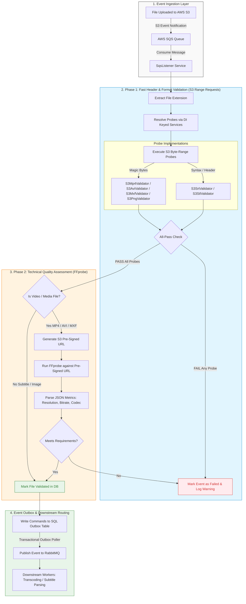

# IEvent objects description

## ValidateMediaAssetEvent
This event is occured when the `FileChanged` event is received from the AWS storage. 

|Parameter|Type|Default|Comments|
|---|---|---|---|
|Id|Guid||Unique event Id|
|ReferenceId|Guid||MediaPackage unique Id|
|CreatedAt|DateTimeOffset||Date and time created|
|FileName|string||the file name is received in the Aws storage|

### **Pipeline Stage Summary**

1. **Ingestion Layer:**
* S3 triggers an event notification to SQS when a file lands in the bucket.
* `SqsListener` pulls the event message containing the file key and bucket name.

2. **Phase 1: Fast Probing (Milliseconds):**
* Extensions map to registered `IFileProbeValidator` implementations (MP4, AVI, MXF, PNG, SRT, STL).
* **S3 Range Requests** fetch only the required header bytes (e.g., 8–1024 bytes) without downloading the full payload.
* Employs **All-Pass Logic**: every probe mapped to that extension must return `true`.

3. **Phase 2: Technical Quality Assessment (Media Files):**
* Non-media files (SRT, STL, PNG) complete validation immediately after Phase 1.
* Video files generate a temporary 15-minute **S3 Pre-signed URL**.
* `FFprobe` reads the metadata container over HTTP via pre-signed URL to verify width, height, bitrate, and codec without downloading the raw video file.

4. **Event Outbox & Downstream Processing:**
* The validation state is recorded in SQL Server inside the transactional outbox table.
* The polling worker publishes a message to RabbitMQ to kick off downstream transcoding or subtitle processing services.

